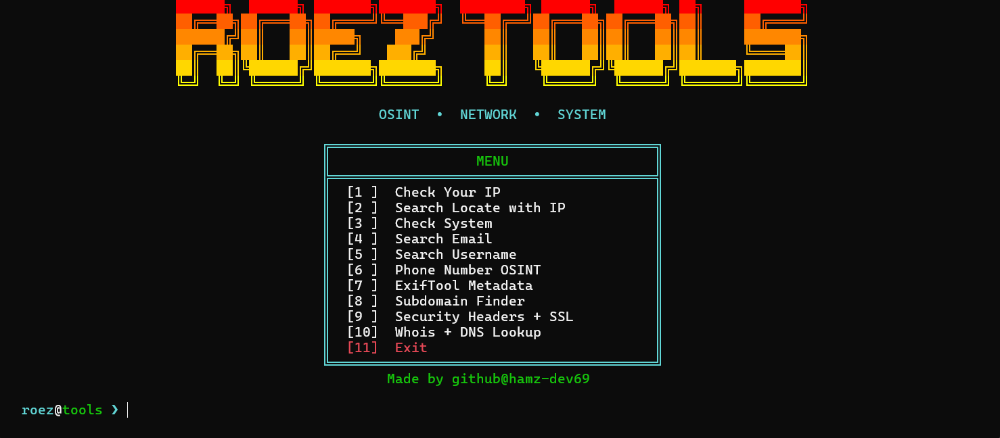

# ROEZ TOOLS

**A menu-driven terminal toolkit for OSINT, network recon, and system checks.**

Python 3 · Linux (Ubuntu / Kali) · Single file · No config



## Overview

ROEZ TOOLS bundles ten commonly used recon utilities behind a single interactive menu. It does not reimplement the heavy lifting: it wraps established tools (Holehe, Sherlock, Subfinder, ExifTool, whois, dig) and parses their output into a clean, readable format, so you don't have to remember flags or switch between terminals.

The whole project is one Python file with a small dependency list.

## Features

| #  | Tool                   | What it does                                                                                    | Powered by                                                           |
| -- | ---------------------- | ----------------------------------------------------------------------------------------------- | -------------------------------------------------------------------- |
| 1  | Check Your IP          | Shows hostname, local IP, and public IP                                                         | `socket`, ipify                                                      |
| 2  | Search Locate with IP  | Country, region, city, ISP, ASN, and proxy/hosting flags for any IP                             | ip-api.com                                                           |
| 3  | Check System           | System summary through `neofetch` or `fastfetch`, with a built-in fallback                      | neofetch / fastfetch                                                 |
| 4  | Search Email           | Lists services where an email address is registered                                             | [Holehe](https://github.com/megadose/holehe)                         |
| 5  | Search Username        | Finds accounts using a username across social platforms                                         | [Sherlock](https://github.com/sherlock-project/sherlock)             |
| 6  | Phone Number OSINT     | Validity, region, carrier, line type, and time zone                                             | [phonenumbers](https://github.com/daviddrysdale/python-phonenumbers) |
| 7  | ExifTool Metadata      | Reads file metadata and flags embedded GPS data                                                 | [ExifTool](https://exiftool.org)                                     |
| 8  | Subdomain Finder       | Passive subdomain enumeration for a domain                                                      | [Subfinder](https://github.com/projectdiscovery/subfinder)           |
| 9  | Security Headers + SSL | Checks six security headers (with a score) and the TLS certificate, including days until expiry | `curl`, Python `ssl`                                                 |
| 10 | Whois + DNS Lookup     | Registrar, creation and expiry dates, nameservers, plus A, AAAA, MX, NS, and TXT records        | whois, dig                                                           |

## Requirements

- Linux (developed and used on Ubuntu and Kali)
- Python 3.8 or newer (Sherlock itself needs Python 3.9+)
- A terminal with 256-color and Unicode support
- Terminal width of at least 85 columns for the logo to render correctly

## Installation

**1. Clone the repository**

```
git clone https://github.com/hamz-dev69/roez-tools.git
cd roez-tools
```

**2. Install system packages**

```
sudo apt update
sudo apt install curl whois dnsutils libimage-exiftool-perl neofetch python3-venv python3-pip
```

**3. Run it**

```
python3 roez-tools.py
```

On the first run, ROEZ TOOLS detects missing OSINT components (`phonenumbers`, `holehe`, `sherlock-project`) and offers to install them automatically into a private virtual environment at `~/.local/share/roez-tools/venv`. Nothing is installed system-wide, so there is no `externally-managed-environment` error and no need for `--break-system-packages`.

**4. Install Subfinder (optional, for tool 8)**

On Kali:

```
sudo apt install subfinder
```

On other distributions, install it with Go:

```
go install -v github.com/projectdiscovery/subfinder/v2/cmd/subfinder@latest
```

`$HOME/go/bin` and `$HOME/.local/bin` are added to the search path automatically.
> Missing tools do not crash the program. If a dependency is not found, the related feature prints the exact install command instead.

## Usage

```
python3 roez-tools.py            # open the menu
python3 roez-tools.py --setup    # install / complete the OSINT components
python3 roez-tools.py --repair   # force a clean reinstall of the OSINT components
python3 roez-tools.py --doctor   # diagnose Python, dependencies, tools, and connectivity
```

Select a feature by typing its number at the `roez@tools ❯` prompt and pressing Enter. After each tool finishes, press Enter to return to the menu. Press `Ctrl+C` during a scan to cancel it and keep any partial results.

### Run it from anywhere (optional)

```
sudo cp roez-tools.py /usr/local/bin/roez
sudo chmod +x /usr/local/bin/roez
```

Then start it with `roez` from any directory.

## Troubleshooting

Run `python3 roez-tools.py --doctor` first; it shows exactly which part is missing or broken.

| Symptom | Cause | Fix |
| ------- | ----- | --- |
| `externally-managed-environment` when installing | Ubuntu 23.04+, Debian 12+, and recent Kali block global `pip` (PEP 668) | Not needed anymore: the tool uses its own venv. Make sure `python3-venv` is installed |
| `holehe` / `sherlock` "not found" right after installing | The scripts were installed to `~/.local/bin`, which is not in `PATH` | Handled automatically; the tool runs them through the Python interpreter that has them |
| Nothing from `requirements.txt` got installed | `pip` installs all-or-nothing: one failing package (e.g. Sherlock on Python 3.8) cancels the rest | Packages are installed one by one, and the failure reason is shown |
| `sherlock-project` fails with "requires a different Python" | Sherlock needs Python 3.9+ | Upgrade Python; other features keep working |
| `Failed building wheel` | Missing compiler for a dependency on an uncommon architecture | `sudo apt install build-essential python3-dev`, then `--setup` again |
| Email search returns nothing | Holehe tried to self-update (`pip install --upgrade holehe`) and exited | The self-update is disabled; Holehe now runs directly |

The install log is written to `~/.local/share/roez-tools/install.log`.

## Platform support

ROEZ TOOLS targets Linux. On Windows, run it inside [WSL](https://learn.microsoft.com/windows/wsl/).

## Notes

- Results may be incomplete or inaccurate. Verify findings independently.
- Use this tool only on targets you own or are authorized to investigate.

## Credits

ROEZ TOOLS integrates work from the authors and maintainers of [Holehe](https://github.com/megadose/holehe), [Sherlock](https://github.com/sherlock-project/sherlock), [Subfinder](https://github.com/projectdiscovery/subfinder), [ExifTool](https://exiftool.org/), [phonenumbers](https://github.com/daviddrysdale/python-phonenumbers),
and the [ip-api](https://ip-api.com/) and [ipify](https://www.ipify.org/) services.

## Author

Made by [hamz-dev69](https://github.com/hamz-dev69)
